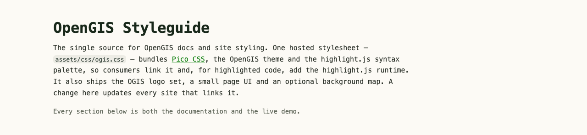
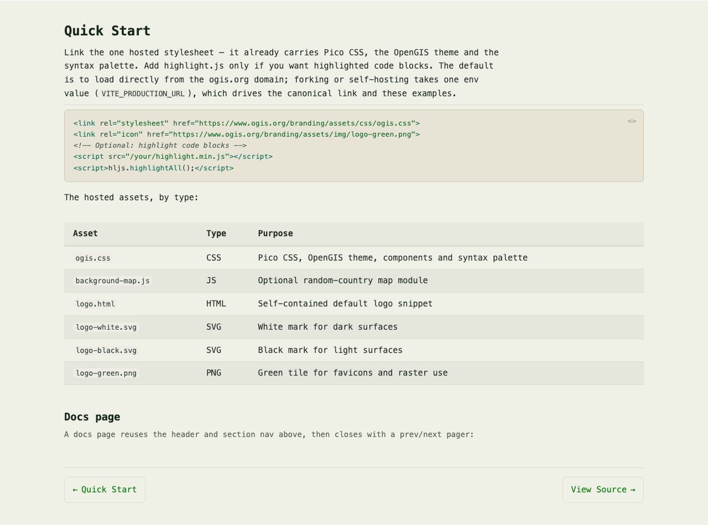
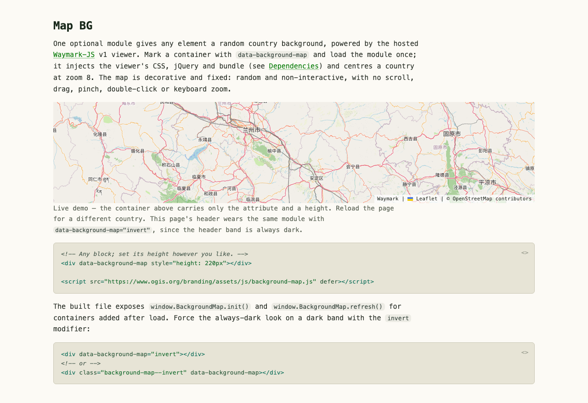
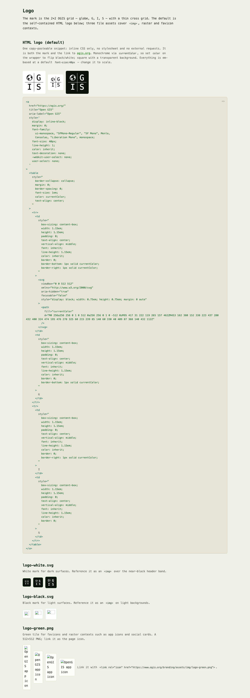
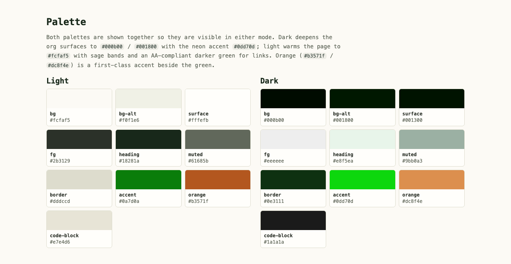
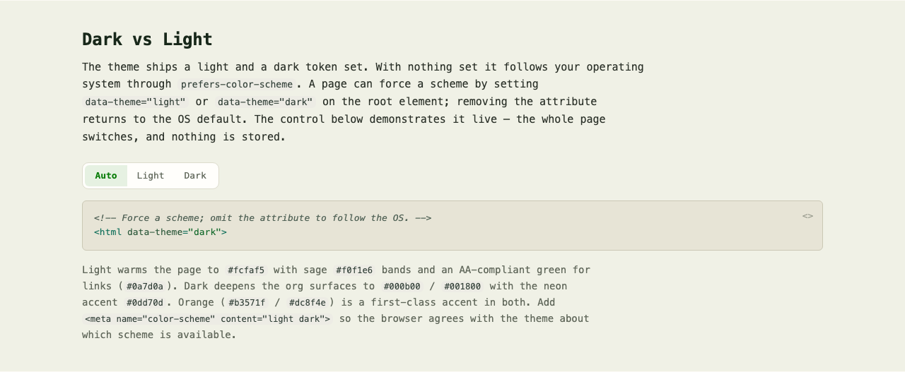
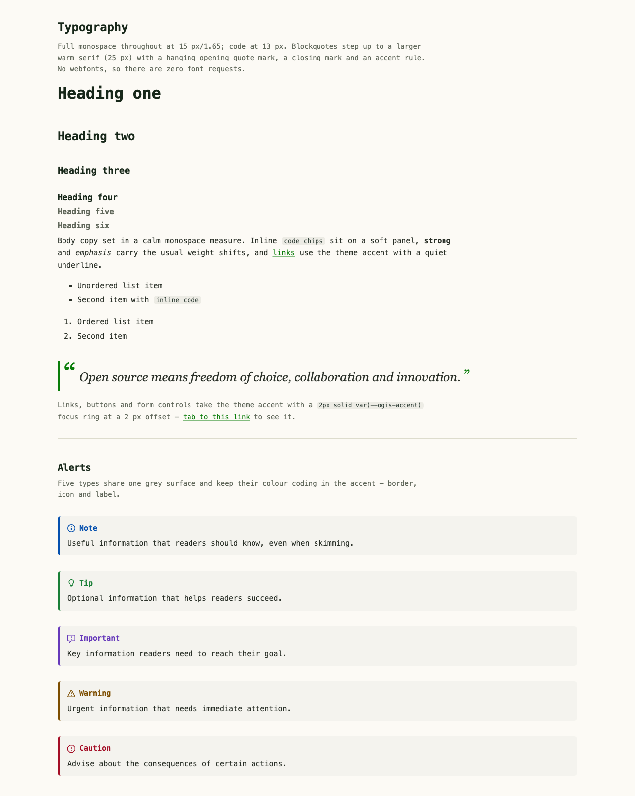
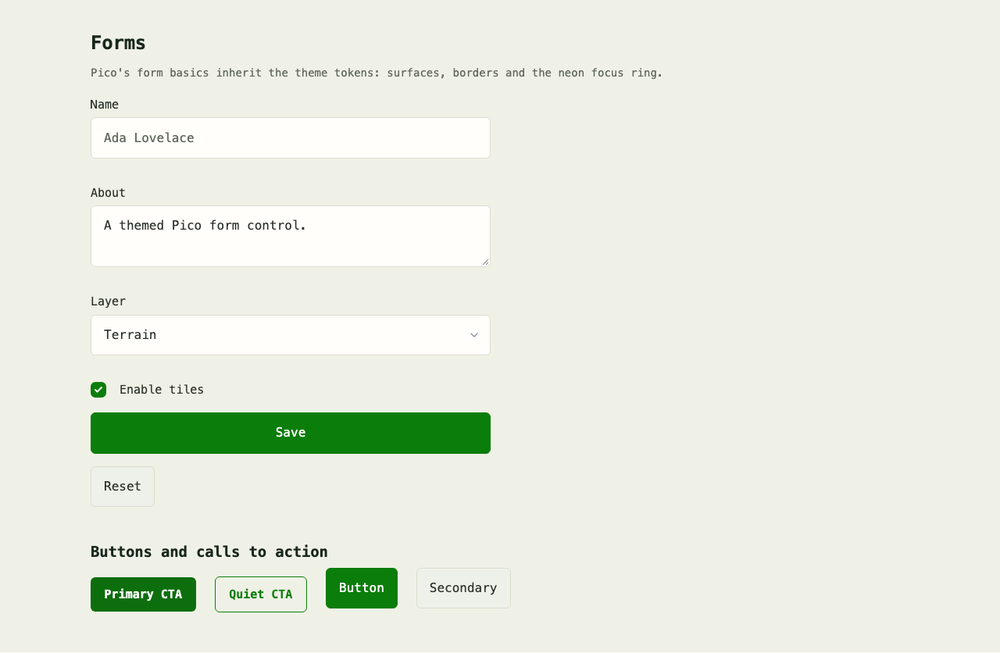
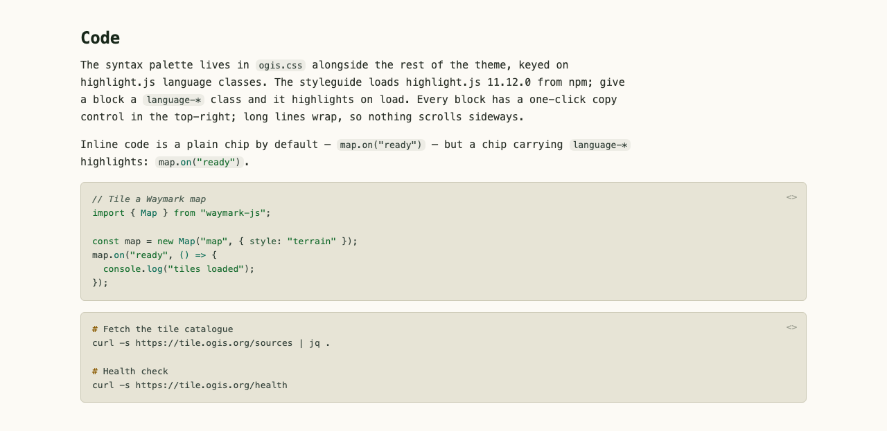
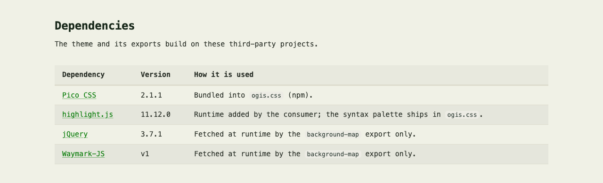

# OpenGIS Branding

One hosted stylesheet carries Pico CSS, the OpenGIS theme and the syntax palette — consumed by linking it (and optionally the JS exports).

## Quick Start

Link the stylesheet; it bundles Pico CSS, the OpenGIS theme and the highlight.js syntax palette, so one request styles the whole page:

```html
<link rel="stylesheet" href="https://www.ogis.org/branding/assets/css/ogis.css" />
```

Code highlighting needs a highlight.js runtime, supplied by the consumer:

```html
<script src="/your/highlight.min.js"></script>
<script>
  hljs.highlightAll();
</script>
```

Paint a decorative random-country background map into any sized block:

```html
<div data-background-map style="height: 220px"></div>
<script src="https://www.ogis.org/branding/assets/js/background-map.js" defer></script>
```

The default is to load from the ogis.org domain; forking or self-hosting takes one env value (`VITE_PRODUCTION_URL`), which drives the page canonical link and the example URLs.

## Local development

```
npm install      # install dependencies
npm run dev      # styleguide on Vite's local URL
npm run build    # build the page and every export
npm run preview  # serve the production build
npm run format   # Prettier write; format:check verifies
```

- **`scss/`** — SASS tree compiled by Vite into `assets/css/ogis.css`. `_pico.scss` holds Pico-related overrides, `_hljs.scss` the highlight.js syntax palette.
- **`src/`** — ESM modules. `ui/` covers sticky nav, scrollspy, heading anchors, theme switch and code copy; `background-map/` is exported. `vite.exports.config.js` with `scripts/build-exports.mjs` builds the exports to `assets/js/<name>.js` IIFE globals.
- **`.env.example`** — defines `VITE_PRODUCTION_URL`; copy it to `.env`.

## Screenshots

The styleguide in full, captured top to bottom:

<a href="screenshots/home.png"></a>

Each band is captured on its own; `npm test` regenerates the whole set.

<details>
<summary>Section screenshots</summary>

| Band                                                                                                                                                                                 | Band                                                                                                                                                                                                          |
| ------------------------------------------------------------------------------------------------------------------------------------------------------------------------------------ | ------------------------------------------------------------------------------------------------------------------------------------------------------------------------------------------------------------- |
| <a href="screenshots/section-hero.png"></a><br>Hero                   | <a href="screenshots/section-quick-start.png"></a><br>Quick Start             |
| <a href="screenshots/section-map-bg.png"></a><br>Map BG | <a href="screenshots/section-logo.png"></a><br>Logo                                                             |
| <a href="screenshots/section-palette.png"></a><br>Palette                      | <a href="screenshots/section-dark-light.png"></a><br>Dark vs Light                           |
| <a href="screenshots/section-typography.png"></a><br>Typography     | <a href="screenshots/section-forms.png"></a><br>Forms                                               |
| <a href="screenshots/section-code.png"></a><br>Code                              | <a href="screenshots/section-dependencies.png"></a><br>Dependencies |

</details>

## Testing

A Playwright smoke suite loads each page in Chromium, waits for the load event and fonts, checks the UI modules initialised, then captures full-page screenshots of the page and each top-level band:

```
npx playwright install chromium  # one-time browser install
npm test                         # run the suite
```

- The suite starts its own isolated Vite dev server on a dedicated port, so it never collides with a running `npm run dev`.
- Chromium is the only configured browser.
- Screenshots are written to `screenshots/` and tracked in git, so visual changes appear in review diffs.

## Dependencies

- [Pico CSS](https://github.com/picocss/pico) — bundled into `ogis.css`.
- [highlight.js](https://github.com/highlightjs/highlight.js) — runtime, consumer-supplied.
- [jQuery](https://jquery.com) — loaded by the background map only.
- [Waymark JS v1](https://github.com/OpenGIS/Waymark-JS) — background map only; GPL-2.0; served from ogis.org, not redistributed.

## Licence

MIT (see [`LICENSE`](LICENSE)).
